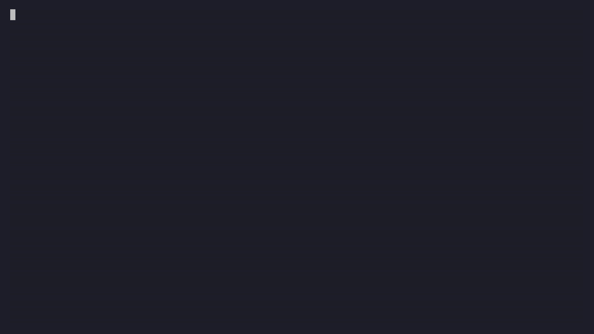

# dopajshell

キー入力、評価、結果、例外のすべてに派手なターミナル演出がつく JShell です。
Ruby の IRB 向けに作られた [dopairb](https://github.com/ko1/dopairb) を Java に移植したもので、JDK 標準の `jdk.jshell` 公開 API と JLine 3 の上に作っています。



JShell としての動きはそのままです。式、文、メソッド、クラス、record、複数行の入力、Tab 補完が使え、結果も `$1 ==> 5050` のような jshell と同じ形式で表示されます。そこにゲームのような演出とスコアが重なります。

## インストール

どの方法でも、起動コマンドは `dopajshell` です（jar を直接使う場合は `java -jar dopajshell.jar`）。
Windows では Windows Terminal での利用をおすすめします（24 ビットカラーに対応しているため）。

### JBang（JDK も自動で用意される）

[JBang](https://www.jbang.dev/) が入っていれば、コマンド 1 つで起動できます。必要な JDK も JBang がダウンロードします。

```console
jbang dopajshell@Shion-Serizawa/dopajshell
```

`dopajshell` コマンドとしてインストールする場合:

```console
jbang app install dopajshell@Shion-Serizawa/dopajshell
```

### Homebrew（macOS / Linux）

```console
brew tap shion-serizawa/dopajshell https://github.com/Shion-Serizawa/dopajshell
brew install shion-serizawa/dopajshell/dopajshell
```

JDK は依存パッケージとして一緒に入ります。

### Scoop（Windows）

```powershell
scoop bucket add dopajshell https://github.com/Shion-Serizawa/dopajshell
scoop install dopajshell/dopajshell
```

JDK 21 以上が PATH に必要です。入っていない場合は `scoop bucket add java` のあと `scoop install java/temurin-lts-jdk` で入れられます。

### jar を直接使う

JDK 21 以上が必要です（JShell を使うので、JRE ではなく JDK が必要です）。
[Releases](https://github.com/Shion-Serizawa/dopajshell/releases/latest) から `dopajshell.jar` をダウンロードして起動します。

```console
curl -LO https://github.com/Shion-Serizawa/dopajshell/releases/latest/download/dopajshell.jar
java -jar dopajshell.jar
```

## 使い方

```console
dopajshell                        # 全開・サウンドあり
dopajshell --calm                 # 控えめ・フラッシュなし・短め
dopajshell --party                # 最大 + 全画面フラッシュ
dopajshell --no-sound --no-flash  # 音とフラッシュを止める
dopajshell -cp lib/foo.jar        # クラスパスに追加
```

`--help` ですべてのオプションが表示されます。環境変数 `DOPAJSHELL` でも設定できます（例: `DOPAJSHELL="intensity=low,flash=off"`）。

### コマンド

jshell のおもなコマンドに加えて、演出を調整する `/dopa` があります。

```
/list /vars /methods /types /imports /drop /open /save /history /reset /env -class-path /! /help /exit
/dopa                  設定とセッションの統計を表示
/dopa on | off | low | normal | max | calm | party
/dopa demo             すべての演出を 1 回ずつ再生（スコアは変わらない）
/dopa flash=off duration=0.5 ...
/dopa help             設定項目の一覧
```

### 設定項目

`/dopa キー=値`、起動オプション `--set キー=値`、環境変数 `DOPAJSHELL` のどれでも設定できます。

| キー | 値（太字が既定値） | 意味 |
| --- | --- | --- |
| `intensity` | off / low / normal / **max** | 演出全体の量 |
| `motion` | **on** / off | アニメーション。off にすると 1 行のバッジだけを表示する |
| `flash` | off / **soft** / full | フラッシュ。soft は演出の範囲だけ、full は画面全体 |
| `sound` | off / bell / **sfx** | sfx は合成した効果音、bell は端末のベル |
| `hud` | **on** / off | プロンプトの右に COMBO / SCORE / CHARGE を表示する |
| `duration` | 数値（**1.0**） | すべての演出の長さにかける倍率（例: 0.5、2） |
| `color` | **auto** / truecolor / 256 / 16 / none | 色数 |
| `trail` | none / **big** / all | 演出のあとに 1 行のバッジを残すかどうか（big は大きな演出だけ） |
| `charge` | 秒数（**0.12**、最大 0.3） | すぐ終わる評価の結果を出す前の「溜め」の長さ。0 で無効 |
| `intro` | **on** / off | 起動時のタイトル演出 |
| `keys` | **on** / off | 入力中のキーごとの演出 |

## ゲームの仕組み

スコアはおもちゃです。コードの長さや正しさではなく、**入力のリズム**と**エラーからの立ち直り**に点が入ります。

- **COMBO**: 評価が続けて成功した回数です。エラーが出ると 0 に戻ります。10 以上で **FEVER** になります。
- **CHARGE**: 入力中にたまるゲージです。括弧、文字列、`{ }` ブロック、Tab 補完、改行、貼り付けで多くたまり、同じ文字の連打ではほとんどたまりません。評価が成功するとスコアに加算され、クリティカルが出やすくなります。
- **クリティカル / ジャックポット**: 成功時に一定の確率でスコアが 2〜8 倍（クリティカル）、まれに 16 倍（ジャックポット）になります。
- **タイピング連続数**: 0.6 秒以内に続けて打ったキーの数です。8、16、32 … 1024 に達すると `8-BIT RUSH!` から `1KiB TYPING LEGEND!!!` までの演出が出ます。
- **FIXED! / COMEBACK!**: エラーのあとに成功すると出ます（2 回以上続いたエラーからの成功なら COMEBACK!）。
- **レベル**: スコアは経験値としてたまり、必要な経験値は 1 レベルごとに倍になります（LV2 は 512、LV3 は 1024 …）。経験値、レベル、ベストスコア、連続日数は保存され、次回の起動に引き継がれます。
- `/exit` すると、ランク付きの全画面リザルトが出ます。

入力中の演出には、ほかに次のものがあります。

| 操作 | 演出 |
| --- | --- |
| 括弧を閉じる | `NICE!` |
| `}` でブロックを閉じる | `SEALED!` |
| Tab 補完 | `<< LOCK ON` |
| 履歴の呼び出し | `<< REWIND` |
| 複数行の入力の継続 | `CHARGE LV2` |
| 貼り付け | `PASTE x120` |

## 結果ごとの演出

| 結果 | 演出 |
| --- | --- |
| `void` / `null` | 空振りと煙 |
| `true` / `false` | `YES!` / `NO!` のスタンプ |
| 10,000 以上の数 | 巨大な数字のカウントアップと衝撃波 |
| 長い `String` | 文字が流れ込む |
| 配列、`List`/`Set`、`Map` | 要素が順に現れる |
| メソッド / クラス / interface / enum / record の定義 | `NEW ABILITY`、`NEW CLASS` など |
| 20 行以上の出力 | `OUTPUT RAIN` |
| 構文エラー | エラー位置で入力行にひびが入る（`SYNTAX BREAK`） |
| `cannot find symbol` | その名前にスポットライト（`UNKNOWN SYMBOL`） |
| メソッドが見つからない、`NullPointerException` | つながりが切れる（`NO METHOD` / `NULL POINTER`） |
| 型の不一致、`ClassCastException`、引数違い、`NumberFormatException` | `TYPE CLASH` / `ARGUMENT CLASH` |
| その他の例外 | 赤いフラッシュとグリッチする `FAILED` |
| 長い評価中の Ctrl-C | `INTERRUPTED` |

成功したときは、まず結果の演出が出ます。そのあと、その評価で達成したこと（`LEVEL UP!`、`FIXED!` / `COMEBACK!`、`COMBO 10!`、`NEW RECORD`、`FIRST HIT!` など）があれば、バナーが 1 つ続きます。ジャックポットとクリティカルは結果そのものの演出として出ます。

サウンドは実行時に合成し、`javax.sound` でプロセス内から直接鳴らします（音声ファイルも外部プレイヤーも不要です）。

## 読みやすさは壊さない

- 評価と結果の報告は JShell のとおりです。演出のあとに jshell 標準の出力（`$1 ==> 5050`、`|  created method ...`、キャレット付きのエラー、スタックトレース付きの例外）を表示します。
- 演出は一時的な領域に描いて消します。スクロールバックに残るのは、入力、プログラムの出力、結果（と、設定によっては 1 行のバッジ）だけです。
- 評価中にプログラムが出力すると、演出はすぐに引っ込みます。
- 演出中にキーを押すと演出はすぐ終わり、そのキーは行エディタに渡ります。
- パイプやリダイレクトで実行したときと `TERM=dumb` のときは、制御シーケンスを一切出さず、jshell 形式の出力だけを出します。
- 演出の中で例外が起きても、REPL には影響しません。

## 環境変数

| 変数 | 意味 |
| --- | --- |
| `DOPAJSHELL` | 設定（例: `intensity=low,flash=off`） |
| `DOPAJSHELL_PROFILE=off` | 経験値やレベルを保存しない。保存先は Windows では `%LOCALAPPDATA%\dopajshell\profile.json`、それ以外では `~/.local/state/dopajshell/profile.json` |
| `DOPAJSHELL_SOUND=off` | 音を無効にする |
| `DOPAJSHELL_SEED=n` | 確率で決まる要素（クリティカルなど）を再現できるようにする |
| `DOPAJSHELL_DEBUG=パス` | 演出の中で起きた例外などのログを出す |

## 開発する

JDK は [mise](https://mise.jdx.dev/) で固定しています（`mise.toml`: Corretto 25）。ビルドには JDK 25、実行には JDK 21 以上が必要です。

```console
mise install          # 初回のみ: JDK をインストール
./gradlew fatJar      # build/libs/dopajshell-all.jar ができる
bin/dopajshell        # 起動（Windows では .\gradlew.bat fatJar と .\bin\dopajshell.cmd）
./gradlew test        # 全シーンを複数の幅・色数で描画するテストと、全サウンドの合成テスト
```

mise を使わない場合は、JDK 25 を入れて `JAVA_HOME` を設定してください。
`bin/dopajshell`（`.cmd`）は `build/libs/dopajshell-all.jar` を起動するだけのスクリプトです。

### 構成

- `Repl`: JShell の起動と管理（リモート実行エンジン。Ctrl-C は `JShell.stop()` で実行中の snippet を止める）、評価ループ、コマンド、`SourceCodeAnalysis` による補完。
- `DopaLineReader`: JLine 内部への依存はすべてここにまとめています。`getWidget`（キーごとの前後比較）、`getDisplayedBufferWithPrompts`（火花の軌跡と下段のエフェクト帯）、`redisplay`（右プロンプトとしての HUD）、`cleanup`（確定した入力のスナップショット）。
- `Probe` / `Feedback`: snippet イベントの分類と、jshell 形式の出力テキスト。
- `Game`: COMBO / CHARGE / SCORE とレベルの計算。
- `InputFx`、`Director`、`scenes/*`、`Canvas`、`Stage`、`Sound`: 入力中の演出、結果の演出、描画、効果音の合成。

JShell をどう組み立て直しているかは [docs/jshell-customization.md](docs/jshell-customization.md) にまとめています。

### リリース

`build.gradle` の `version` を上げてコミットし、同じ番号のタグ（例: `v0.1.0`）を push します。GitHub Actions がテストを実行し、`dopajshell.jar` を添付した Release を作ります。そのあと、Scoop（`bucket/`）と Homebrew（`Formula/`）のマニフェストを新しいバージョンとハッシュに更新して `main` にコミットします。JBang（`jbang-catalog.json`）は常に最新の Release を指すので、更新は要りません。

デモ GIF は `docs/demo.tape` から [VHS](https://github.com/charmbracelet/vhs) で録画しています（手順はファイルの先頭に書いてあります）。

## ライセンス

[MIT License](LICENSE)

## Special Thanks

- [ko1 (Koichi Sasada)](https://github.com/ko1) さん — 元になった [dopairb](https://github.com/ko1/dopairb) の作者です。ゲームの仕組み、演出、サウンドの設計はすべて dopairb に由来します。素敵なツールを MIT ライセンスで公開してくださったことに感謝します。
