# JShell をカスタマイズするための方策

このドキュメントは、dopajshell が「JShell を自前で組み立て直す」ためにどんな方策を取ったかをまとめたものです。
演出（COMBO、シーン、サウンドなど）の中身には触れず、**JShell と行エディタにどう手を入れたか**だけを扱います。

---

## 0. 結論: jshell ツールは使わず、エンジンとエディタを組み直した

JDK の `jshell` コマンド（`jdk.internal.jshell.tool`）は内部パッケージで、プロンプト・入力・出力に外から手を入れる口がほとんどありません。
そこで dopajshell は、jshell ツールを丸ごと使うのをやめ、次の 2 つの**公開部品**を自分でつなぎ直しています。

| 部品 | 役割 | 由来 |
| --- | --- | --- |
| `jdk.jshell.JShell` | Java スニペットの解析・コンパイル・実行（評価エンジン） | JDK 標準の公開 API（`jdk.jshell` モジュール） |
| `org.jline.reader.LineReader` | 行編集・履歴・補完・ハイライト・端末制御 | JLine 3（jshell ツール自身も内部で使っているもの） |

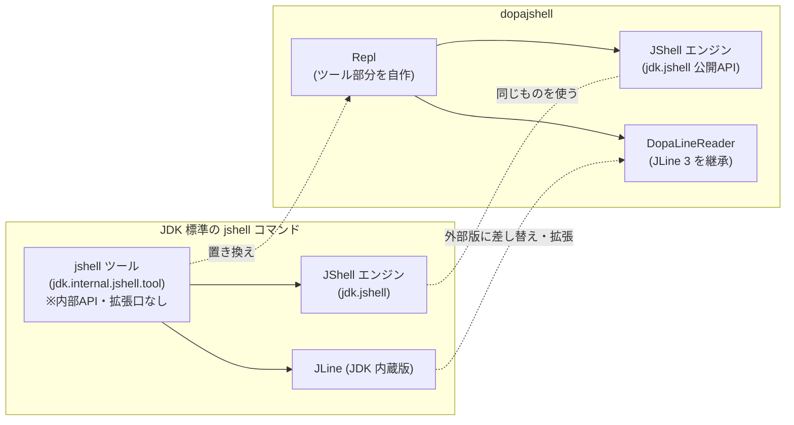

この判断により、ツール部分（ループ、コマンド、フィードバック出力）をすべて自分で書く必要が出ました。
以降の各節は、その「自分で書いた部分」で取った方策です。

---

## 1. 全体アーキテクチャ

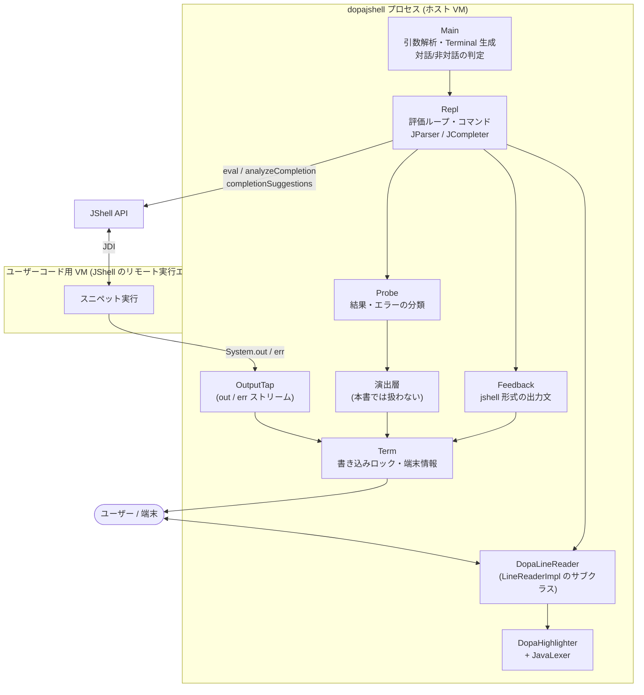

ポイントは 3 つです。

1. **評価は JShell に任せる。** Java の解釈は一切自作しない。
2. **入力まわりは JLine の差し替え点（Parser / Completer / Highlighter）と、継承による protected フックで拡張する。**
3. **出力はすべて自分で組み立てる。** プログラム出力は `OutputTap`、結果表示は `Feedback` が担当し、どちらも `Term` の単一ロックを通る。

---

## 2. JShell エンジンの組み立て方

### 2.1 `JShell.builder()` で差し込んでいるもの

`Repl.boot()`（[Repl.java](../src/main/java/dopajshell/Repl.java)）で JShell を生成するとき、次の点をカスタマイズしています。

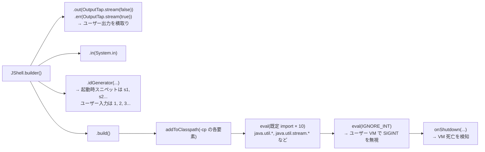

- **ID の採番を自分で持つ。** 起動時のスニペット（import など）には `s` を付けて区別し、`/list` や `/save` で「ユーザーが打ったものだけ」を取り出せるようにしています（`userSnippets()`）。これは本家 jshell の `s1`… と同じ見た目を再現する狙いもあります。
- **既定 import を自前で流す。** 本家 jshell の `DEFAULT` スタートアップ相当を `DEFAULT_IMPORTS` として持ち、起動直後に `eval` しています。
- **ユーザー VM の SIGINT を潰す。** JShell の既定実行エンジンはユーザーコードを別 VM で動かします。端末で Ctrl-C を押すとプロセスグループ全体に SIGINT が飛ぶので、そのままだとユーザー VM が死にます。`sun.misc.Signal.handle(...)` をスニペットとして評価し、子 VM 側では無視させています（中断の方法は §6）。

### 2.2 起動を待たせない: 非同期ブート

JShell の起動（別 VM の起動を含む）は数百 ms〜秒単位かかるので、`CompletableFuture.supplyAsync` で裏で起動し、タイトル表示などと並行させています。

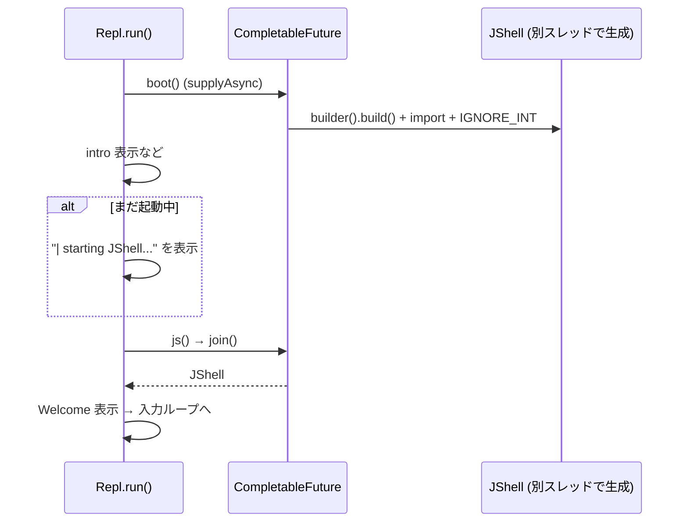

### 2.3 エンジンが死んだら作り直す

`System.exit()` を呼ばれるなどしてユーザー VM が落ちると、`JShell.eval` は `IllegalStateException` を投げます。
dopajshell はこれを捕まえて `restart()` し、新しいエンジンを裏で起動し直します（本家の「State engine terminated.」と同じ挙動）。`onShutdown` で死亡を検知した場合も、次の評価時に作り直します。

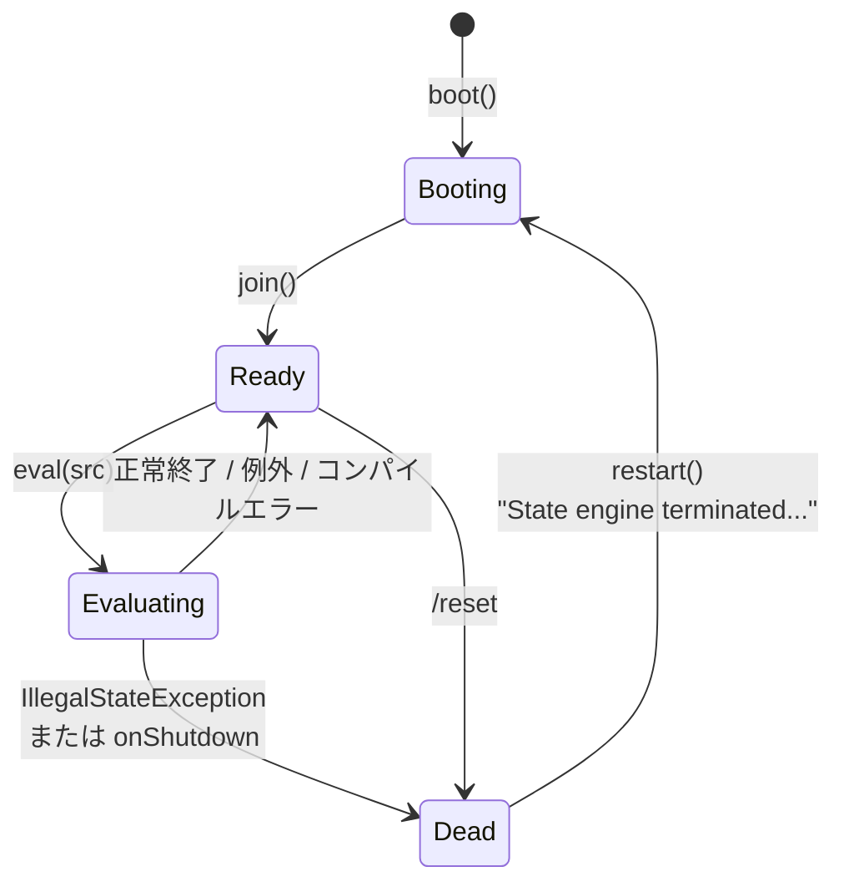

---

## 3. 入力: 複数行と複数スニペットの扱い

JShell 本体は「1 回の `eval` に 1 スニペット」しか受け付けません。一方ユーザーは `int a = 1; int b = 2;` のように 1 行に複数書いたり、`{` を開いたまま改行したりします。
これを **`SourceCodeAnalysis.analyzeCompletion()`** 一本で解決しています。

### 3.1 Enter を押したとき: 続きが要るか判定する

JLine は Enter で `Parser.parse(..., ACCEPT_LINE)` を呼びます。自作の `JParser` は入力が未完なら `EOFError` を投げ、JLine に「確定せず継続行を出せ」と伝えます。

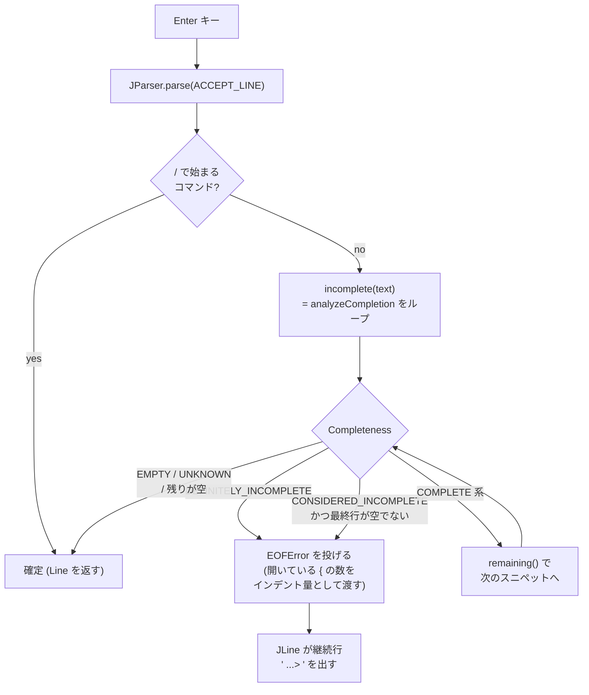

- `CONSIDERED_INCOMPLETE`（例: `int x = 1` のようにセミコロン抜けでも成立しうるもの）は、**空行を打ったら確定**というルールにしています。
- `EOFError` の第 5 引数に `{` のネスト数を渡すと、JLine が `INDENTATION`（4）に従って自動インデントしてくれます。数えるのは軽量な自作 `JavaLexer` です。

### 3.2 確定後: スニペットに分割して 1 つずつ評価する

`Repl.evaluate()` は確定した入力を、同じ `analyzeCompletion` で頭から切り出して `evalSnippet()` に渡します。

```mermaid
sequenceDiagram
    participant R as Repl.evaluate(input)
    participant S as SourceCodeAnalysis
    participant E as evalSnippet
    Note over R: input = "int a = 1; int b = a + 1;"
    R->>S: analyzeCompletion(remaining)
    S-->>R: source="int a = 1;" remaining=" int b = a + 1;"
    R->>E: eval("int a = 1;", srcOffset=0)
    R->>S: analyzeCompletion(" int b = a + 1;")
    S-->>R: source="int b = a + 1;" remaining=""
    R->>E: eval("int b = a + 1;", srcOffset=11)
```

`srcOffset`（そのスニペットが入力全体のどこから始まるか）を持ち回しているのは、構文エラーの位置を**画面上の入力行の座標**に戻すためです（`Probe.locate`）。

### 3.3 非対話モードでも同じロジック

パイプやリダイレクトのときは JLine を使わず `BufferedReader` で 1 行ずつ読みますが、継続判定は同じ `incomplete()` を使っています（`runPlain()`）。

---

## 4. 補完: JShell の `completionSuggestions` を JLine につなぐ

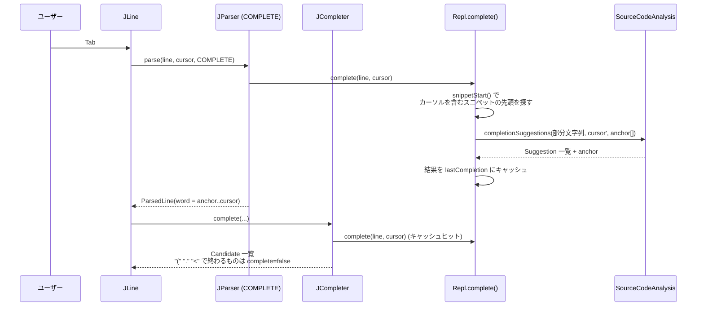

工夫しているのは次の 3 点です。

- **単語境界を JShell に決めさせる。** JLine 既定のパーサは空白区切りで単語を切りますが、Java では `list.str|` の「単語」は `str` です。`completionSuggestions` が返す `anchor` をそのまま `ParsedLine.word()` の開始位置にしています（自作 record `Line`）。
- **複数スニペットの行でも効く。** `int a = 1; a.toS|` のような行では、カーソルを含むスニペットだけを切り出して渡し、`anchor` を元の座標に足し戻します。
- **二重計算を避ける。** JLine は Parser と Completer の両方から呼ぶので、`(line, cursor)` が同じなら前回の結果を返します。
- `/` で始まる行は JShell に渡さず、コマンド名と `/dopa` の引数を自前で候補にします。

---

## 5. 行エディタ: `LineReaderImpl` を継承して 4 つのフックを使う

JLine の公開インターフェース（`Highlighter`、`Parser`、`Completer`、ウィジェット）だけでは「キーを押すたびの前後比較」や「入力行の右・下への描き足し」ができません。
そこで `LineReaderImpl` を継承し、**protected メソッドを 4 つ**オーバーライドしています。JLine 内部への依存は**すべて [DopaLineReader.java](../src/main/java/dopajshell/DopaLineReader.java) 1 ファイルに閉じ込める**方針です（JLine 3.30 で検証）。

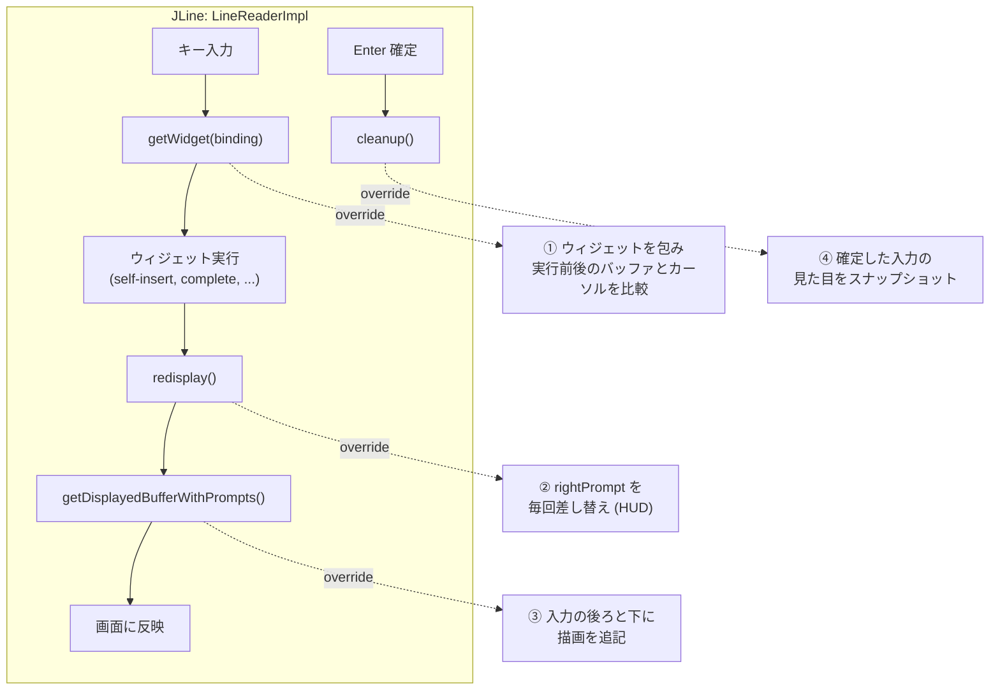

| フック | 何に使っているか | 公開 API だけで無理な理由 |
| --- | --- | --- |
| `getWidget(Object)` | 元のウィジェットをラムダで包み、`buf` の前後と画面上のカーソル X を比較 | ウィジェット単位の「前後」を取る公開フックがない |
| `redisplay(boolean)` | 再描画のたびに `rightPrompt` を作り直す | 右プロンプトは `readLine` 時に固定される |
| `getDisplayedBufferWithPrompts(List)` | 表示用の `AttributedString` の末尾に文字列や改行＋数行を足す | `Highlighter` は入力文字列の着色しかできない |
| `cleanup()` | 確定直後、プロンプトと色付き入力をそのまま保存 | 確定後は画面上の入力行の情報が失われる |

### 5.1 アニメーション用のティッカー

JLine はキー入力がないと再描画しません。そこでデーモンスレッドが 1/30 秒ごとに、アニメーション中に限り**公開 API の `callWidget(REDISPLAY)`** を呼んで再描画させています。

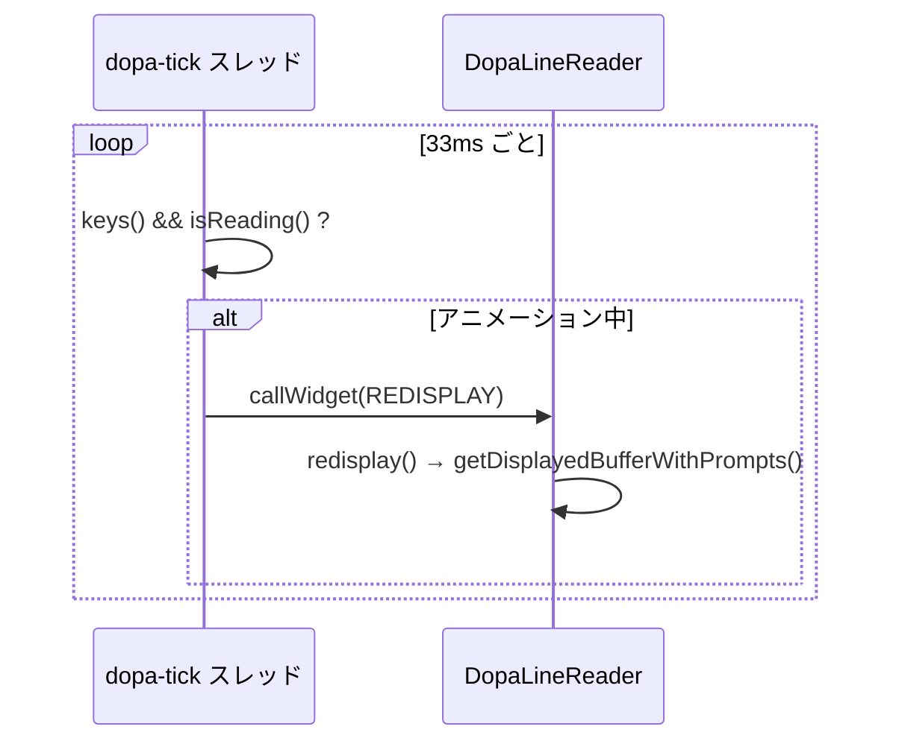

### 5.2 壊れても REPL は止めない

フック内の処理はすべて `try/catch` で囲み、例外が出たら `broken = true` にして**以後は素の `LineReaderImpl` として動く**ようにしています。JLine の内部実装が変わっても、最悪「普通の jshell」に戻るだけです。

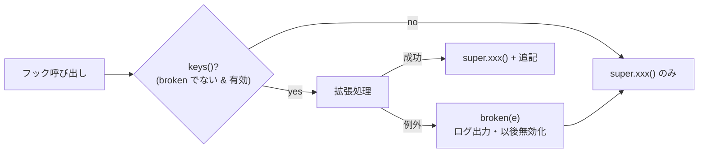

### 5.3 貼り付けは軽く

`self-insert` のときに端末の入力バッファにまだ文字が残っていれば（＝貼り付け中）、レイアウト計算を飛ばして文字数だけ数えます。大量貼り付けで 1 文字ごとに重い処理が走るのを防ぐためです。

### 5.4 画面がスクロールしない領域の確保

入力行の下に数行を描くと、画面最下段ではスクロールが起きてしまいます。そこで `beforeRead()` で毎回、

1. 空行を `STRIP_ROWS` 行出してからカーソルを戻す（下に余白を確保）
2. `getCursorPosition()` でプロンプトの画面行を記録する

を行い、`roomForStrip()` で「入力が伸びて余白がなくなったら下段の描画をやめる」判定をしています。

### 5.5 シンタックスハイライト

`Highlighter` インターフェースは公開 API なので、こちらは素直に実装しています（[DopaHighlighter.java](../src/main/java/dopajshell/DopaHighlighter.java)）。

- トークナイズは JShell ではなく自作の `JavaLexer`。**未完成の入力でも例外を投げない**ことを優先した寛容なレキサーです（キーごとに呼ばれるので JShell の解析は重すぎる）。
- 同じレキサーを §3.1 の `{` 数え、`cleanup()` 時のスナップショット着色にも使い回しています。
- 色数ゼロ（`NO_COLOR` など）のときは着色しません。

---

## 6. Ctrl-C: 端末シグナルを `JShell.stop()` に変換する

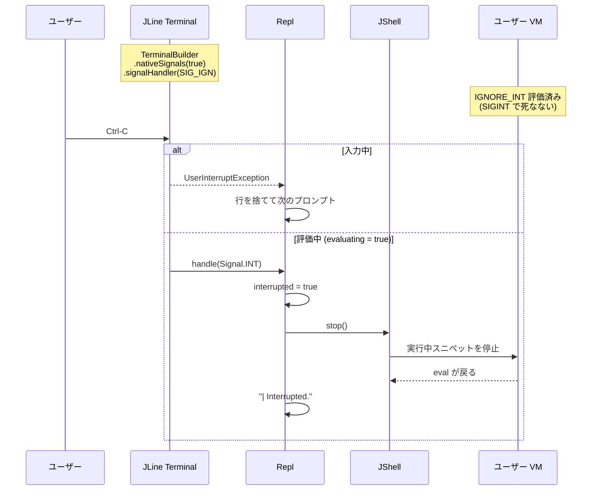

- ホスト VM 側は `signalHandler(SIG_IGN)` で既定動作（プロセス終了）を止め、`terminal.handle(INT, ...)` で自前処理に置き換えています。
- ユーザー VM 側は §2.1 の `IGNORE_INT` で無視させ、止めるのは JShell の正規ルート（`JShell.stop()`）だけにしています。

---

## 7. 出力: ユーザープログラムの出力を横取りする

`JShell.builder().out()/.err()` に自作の `PrintStream`（[OutputTap.java](../src/main/java/dopajshell/OutputTap.java)）を渡しているので、ユーザーコードの `System.out.println` はすべてここを通ります。

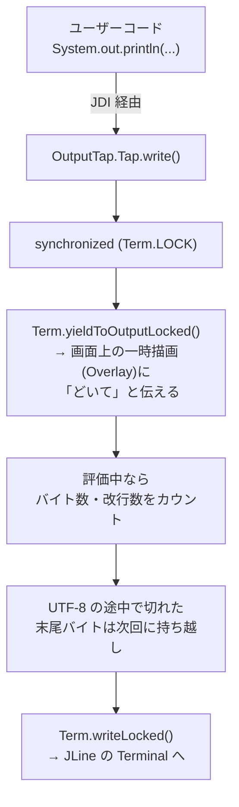

- **単一ロック `Term.LOCK`。** 端末に書くものはすべてこのロックを通ります。評価中のスピナーなど一時的な描画は `Term.Overlay` として登録され、ユーザー出力が来るとロック内で消えてから出力が書かれます。表示が混ざって崩れることがありません。
- **UTF-8 境界の処理。** リモート VM からの出力はバイト列で、マルチバイト文字の途中で分割されて届くことがあります。末尾の不完全なシーケンスは `pending` に残して次の `write` とつなげています。
- **カウント。** 評価中の出力行数・出力の有無を数え、「出力があったか」で後続処理（§8）を変えています。
- 端末がない場合（非対話）は `System.out` / `System.err` にそのまま流します。

---

## 8. 結果表示: jshell のフィードバックを自前で再現する

jshell ツールを使わない以上、`$1 ==> 5050` や `|  created method foo()` といった表示も自分で作る必要があります。
ここは**「見るためのテキスト」と「判断するための情報」を分ける**方針にしました。

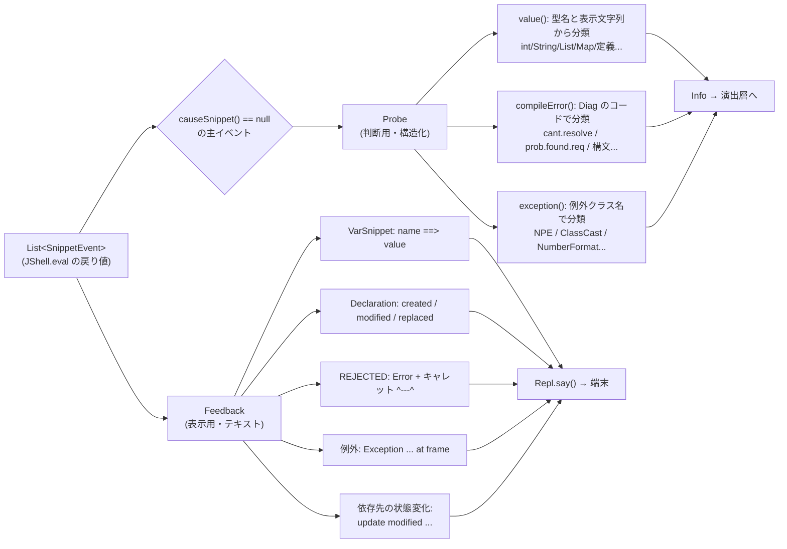

### 8.1 `Feedback`: jshell の normal モードの文言を再現

[Feedback.java](../src/main/java/dopajshell/Feedback.java) は `SnippetEvent` の `status` / `previousStatus` / `value` / `exception` から、本家の normal フィードバックモードと同じ文を組み立てます。

- `RECOVERABLE_DEFINED` などの「未解決の依存がある」状態では `, however, it cannot be invoked until ... is declared` を付ける（`unresolvedDependencies` を使用）
- 診断メッセージは `Diag.getStartPosition()` / `getEndPosition()` からキャレット行を生成
- スタックトレースは、JShell が生成するラッパークラス（`$JShell$12` や `do_it$`）を `#12:1` のような本家風の表記に整形（`frame()`）

### 8.2 `Probe`: ユーザー VM で追加評価しない

結果の分類は **`SnippetEvent` に既に入っている情報（静的型名と表示文字列）だけ**で行っています。
例えば `List` の要素数を知るために `list.size()` を追加で `eval` したりはしません。

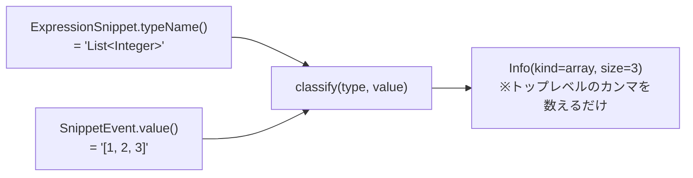

理由は 2 つです。

- 追加評価すると `$` 変数や副作用（`toString()` が状態を変えるなど）が増え、ユーザーのセッションを汚す
- 追加評価は別 VM との往復になり遅い

コンパイルエラーは `Diag.getCode()`（`compiler.err.cant.resolve.location` など）で分岐し、メッセージは `getMessage(Locale.ENGLISH)` で取って正規表現で型名などを抜いています。表示用の `Feedback` 側は `Locale.getDefault()` を使うので、利用者には自分のロケールのメッセージが出ます。

### 8.3 1 スニペットの評価サイクル全体

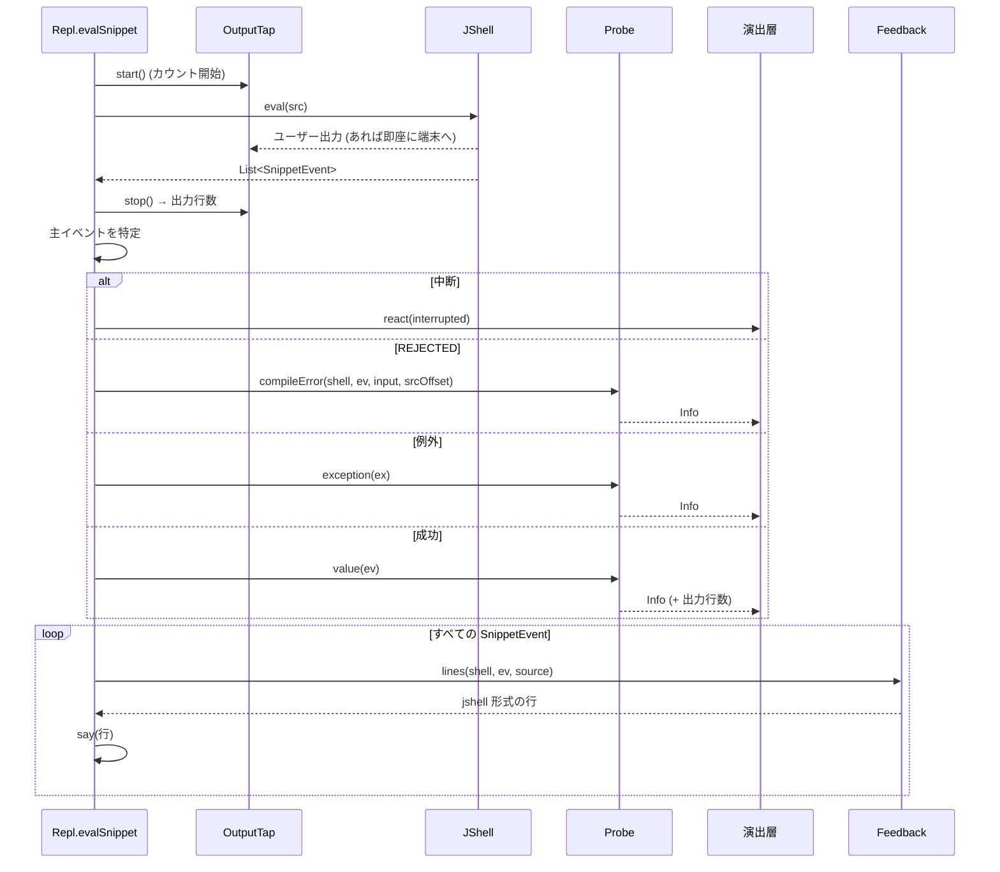

演出のあとに必ず jshell 形式のテキストを出すので、スクロールバックに残る内容は本家 jshell とほぼ同じになります。

---

## 9. コマンド: 本家のサブセットを自前実装

`/` で始まる入力（`//` と `/*` は除く）は JShell に渡さず `Repl.command()` で処理します。すべて JShell の公開 API の組み合わせです。

| コマンド | 使っている API |
| --- | --- |
| `/list [-all]` | `snippets()` + `status().isActive()`、ID の `s` 接頭辞で起動時分を除外 |
| `/vars` | `variables()` + `varValue()` |
| `/methods` / `/types` / `/imports` | `methods()` / `types()` / `imports()` |
| `/drop` | `drop(snippet)`（ID または `PersistentSnippet.name()` で検索） |
| `/reset` | エンジンを捨てて `restart()` |
| `/open` | ファイルを読んで `evaluate()`（＝複数スニペット分割が効く） |
| `/save` | ユーザースニペットの `source()` を連結 |
| `/env -class-path` | `addToClasspath()` |
| `/history` | JLine の `getHistory()` |
| `/!` | 直前の入力を再 `evaluate()` |

本家と同じく**一意な前方一致**（`/l` → `/list`）を受け付けます。

---

## 10. 対話 / 非対話の切り替え

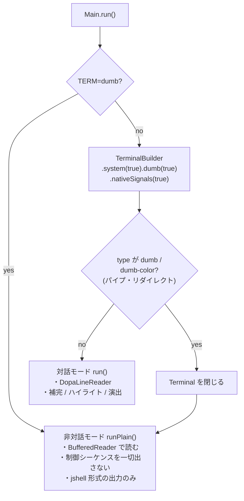

`dumb(true)` を付けておくと、本物の端末が取れないときに JLine が例外ではなく dumb 端末を返すので、それを見て非対話に切り替えています。
これにより `echo '1+1' | dopajshell` のようなスクリプト用途でも壊れた出力になりません。

---

## 11. ビルドと配布

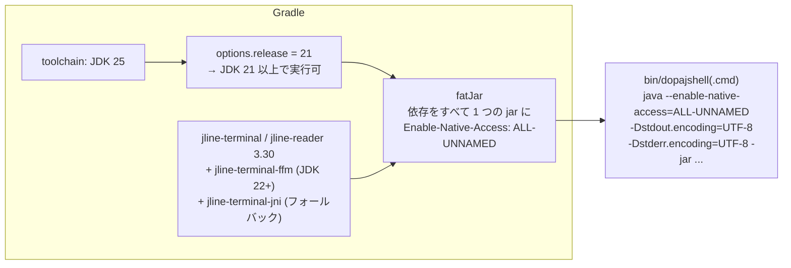

- **JLine は JDK 内蔵版ではなく Maven の JLine 3 を使う。** JDK 内蔵の JLine（`jdk.internal.le`）は内部 API なので、継承やフックができません。
- **端末ネイティブアクセス。** Windows コンソールの raw モードやシグナル処理のため、FFM 版（JDK 22+）を優先し、だめなら JNI 版にフォールバックします。そのため `--enable-native-access` を付けています。
- **`jdk.jshell` はモジュールとして JDK に入っている**ので、追加の依存は不要です（JRE ではなく JDK が必要）。

---

## 12. まとめ: 取った方策とトレードオフ

| 方策 | 得たもの | 払ったコスト |
| --- | --- | --- |
| jshell ツールを捨てて `jdk.jshell` API で組み直す | 入力・出力・ループを完全に制御できる | コマンド・フィードバック文・スタックトレース整形をすべて自作 |
| `analyzeCompletion` で継続判定とスニペット分割 | 本家と同じ複数行・複数文の挙動 | `CONSIDERED_INCOMPLETE` の扱いなど細部は独自ルール |
| `completionSuggestions` の `anchor` を JLine の単語境界にする | Java として正しい補完 | Parser と Completer の二重呼び出しにキャッシュが必要 |
| `LineReaderImpl` を継承して protected フックを使う | キー単位の前後比較、入力行周辺への描画 | JLine 内部への依存（1 ファイルに隔離、失敗時は素の動作に退避） |
| `out/err` を自作 `PrintStream` に差し替え | 出力と一時描画の衝突を防げる | UTF-8 境界やロックの管理を自前で |
| `SnippetEvent` だけで結果を分類 | ユーザーのセッションを汚さない・速い | 表示文字列のパースに頼るので、`toString()` 次第で分類が粗くなる |
| SIGINT を両 VM で無視し `JShell.stop()` で止める | Ctrl-C で REPL もユーザー VM も死なない | `sun.misc.Signal` という準内部 API を子 VM で使う |
| 非対話モードを別ループで用意 | パイプ・CI でも使える | ループが 2 系統になる |
